<div align="center">

<h1>Hackatime Mobile</h1>
</div>

<p align="center">An <b>android app</b> that uses <b>OAuth</b> to get your hackatime data and present it like the original hackatime but on your phone!</p>

> This project has a [devlog](./DEVLOG.md)

## Download and Features
Look at the [lastest release](https://github.com/SiKCube/hackatime-mobile/releases/tag/v1.0) to download, curently the most recent version is: `1.0`


### Login with OAuth
Using `expo-auth-session` and an OAuth flow, this gives you an easy way to log in with your hackatime account, without putting your API_KEY.

<div align="center">
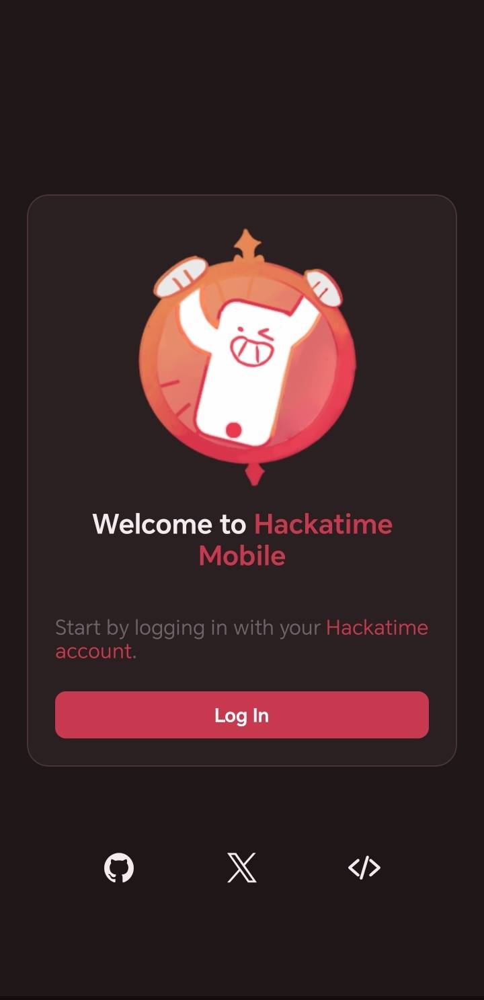
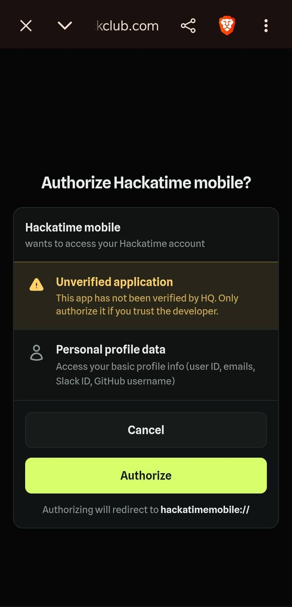
</div>

### Stats dashboard
Using `React Native Chart Kit` and `React Native Svg` we give you charts that look and work like the original hackatime's dashboard charts. Also you can select between the following date options:

| Date options |
|---|
| `All time` |
| `This year` |
| `This Month` |
| `This Week` |
| `Today` |
| `Yesterday` |
| `Last 30 days` |
| `Last 12 months` |

<div align="center">
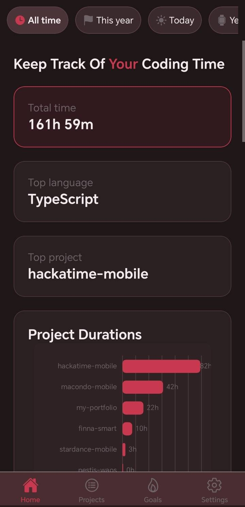
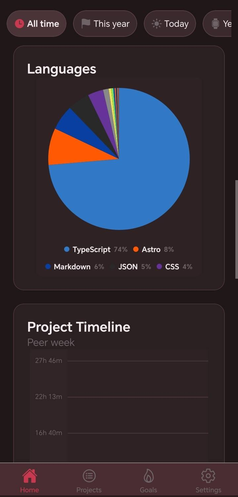
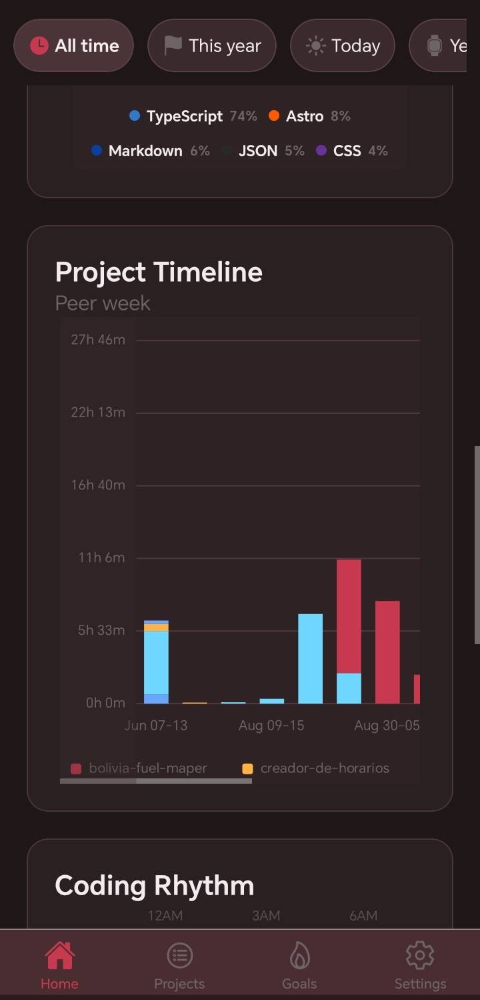
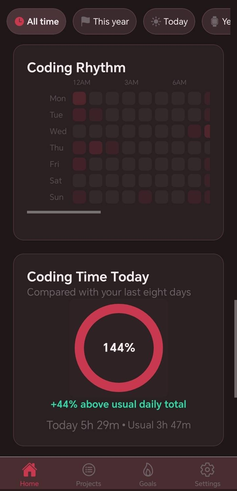
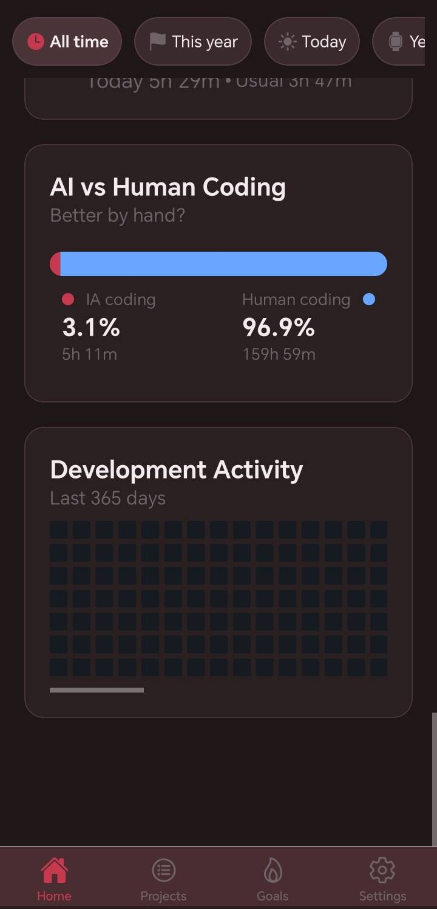
</div>

### Projects list
Like the original hackatime projects tab. You can see a resume of each project, you can access to their github repo and look at their details.

<div align="center">
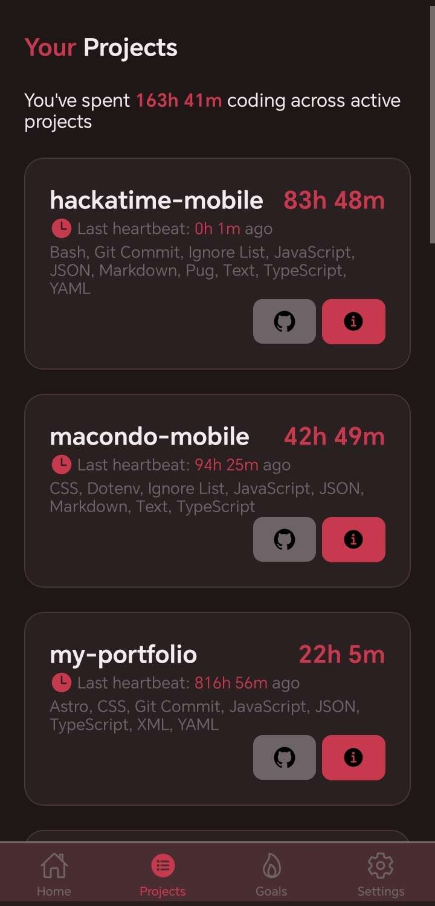
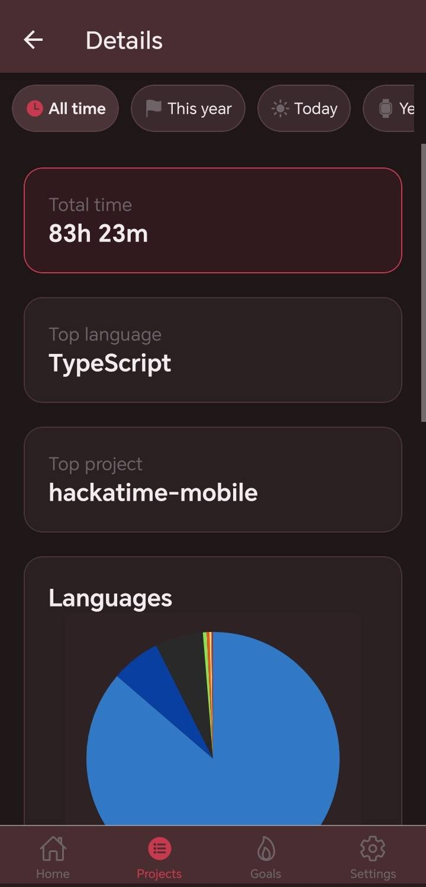
</div>

### Reminders
Using `expo-notifications`, you can select an hour, amount of time, which weekdays and for what projects will you reminder appear. This includes a goal progress card.

<div align="center">
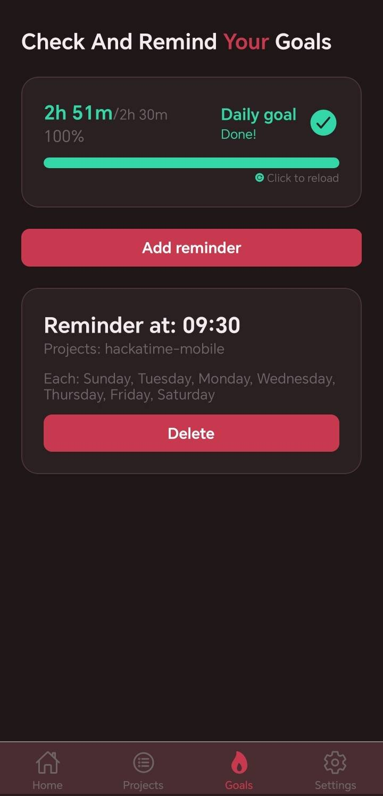
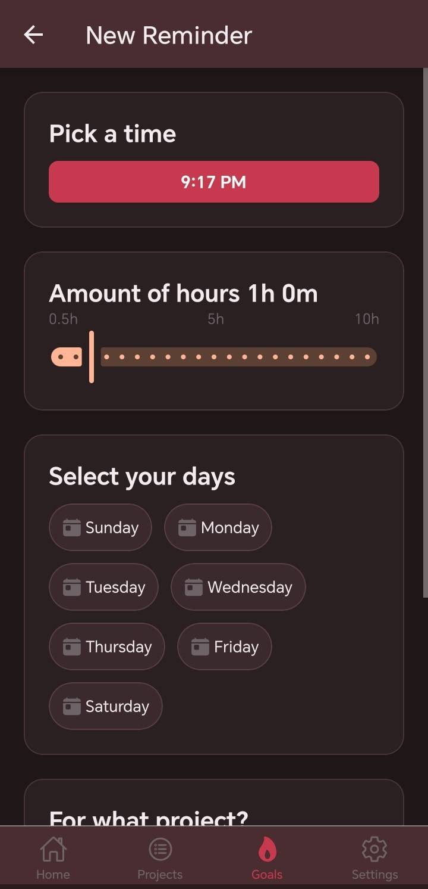
</div>

### Themes
Go to settings and you can pick a theme from the orginal hackatime, this includes the following:

| Themes |
|---|
| `Classic` |
| `Midnight` |
| `Neon` |
| `Catppuchin Mocha` |
| `Catppuchin Ice Latte` |
| `Gruvbox Dark` |
| `GitHub Dark` |
| `GitHub Light` |
| `Nord` |
| `Rose Pine` |
| `Rose Pine Dawn` |
| `AMOLED` |

<div align="center">
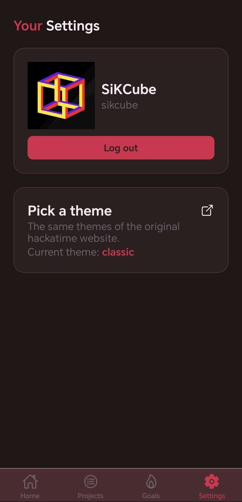
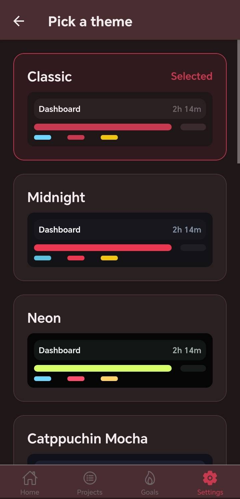
</div>

## Tech Stack
This project was made using: [Expo](https://docs.expo.dev/) and [React Native](http://reactnative.dev/) for the mobile implementation, [React Native Chart Kit](https://chartkit.io/) for some of the charts, [Axios](https://axios.rest/). All written in [VSCode](https://code.visualstudio.com/).

## Project Structure

```text
hackatime-mobile/
|
|── assets/
  |── hacka/ #apk icons
  └── hackatime-mobile.png
|── src/
  |── app/ #app routes
    |── in-app/
      |── projects/
        |── _layout.tsx
        |── [projectId].tsx
        └── index.tsx #projects list
      |── settings/
        |── _layout.tsx
        |── theme.tsx
        └── index.tsx #settings
      |── streak/
        |── _layout.tsx
        |── new-reminder.tsx
        └── index.tsx #reminders
      |── _layout.tsx
      └── index.tsx #dashboard
    |── _layout.tsx
    └── index.tsx #main route
  |── components/
    └── ui/ #general ui components
  |── features/
    |── theme/
    |── stats/
    |── reminders/
    |── profile/
    |── auth-ctx/
    |── auth-screen/
    |── stat-panel/
    |── project-list/
    |── profile/
    └── goal/
|── const.ts #config vars for the project
|── eas.json
└── app.json
```

## How to run it?
```sh
# First Clone the source code
git clone https://github.com/SiKCube/hackatime-mobile && cd hackatime-mobile

# Install the project's dependencies
pnpm install
```

### Create your own Hackatime Oauth app
1. Create the [hackatime oauth app](https://hackatime.hackclub.com/oauth/applications)
2. Select all scopes exept the **Confidencial Application** (mobile apps are insecure so no client secrets).
3. Write the following on the Redirect URIs: `hackatimemobile://` 
4. Put a cool name
5. Submit it
6. Replace the current `APP_UUID` located on the `consts.ts` file with your showed UID after creating the oauth app.


### Development
Because this project uses Oauth. Expo Go, will not work. So use a dev build. Follow [dev builds docs](https://docs.expo.dev/develop/development-builds/introduction/) I recomend you to use EAS is more confortable.

1. Start the development server
```sh
pnpm run start
```

2. Scan the QR code in the dev build instaled on your android phone.

### Build
Build with EAS:
```sh
eas build --platform android --profile production
```

If you dont want to use EAS follow one of the expo guides: [here](https://docs.expo.dev/develop/development-builds/introduction/#how-would-you-like-to-build-your-development-build)

## Idea
The idea appear beacuse I haven't see any mobile app that gives me a similar experience to the hackatime dashboard, and is quite anoying to search, copy and paste your API_KEY in some apps that ofert that. So I made my own, for that I learn to use expo and oauth to make this. 

This would be the first part beacuse there is more things I would like to add and improve. :)

## AI DISCLOSURE
- AI used for researching how to use schedule notifications with `expo-notifications` (asking ChatGPT).
- Ghost text suggestions used beetwen October 25-31 (just for repetitive coding, except when writing docs is funnier by hand).

> Thanks for reading! 
